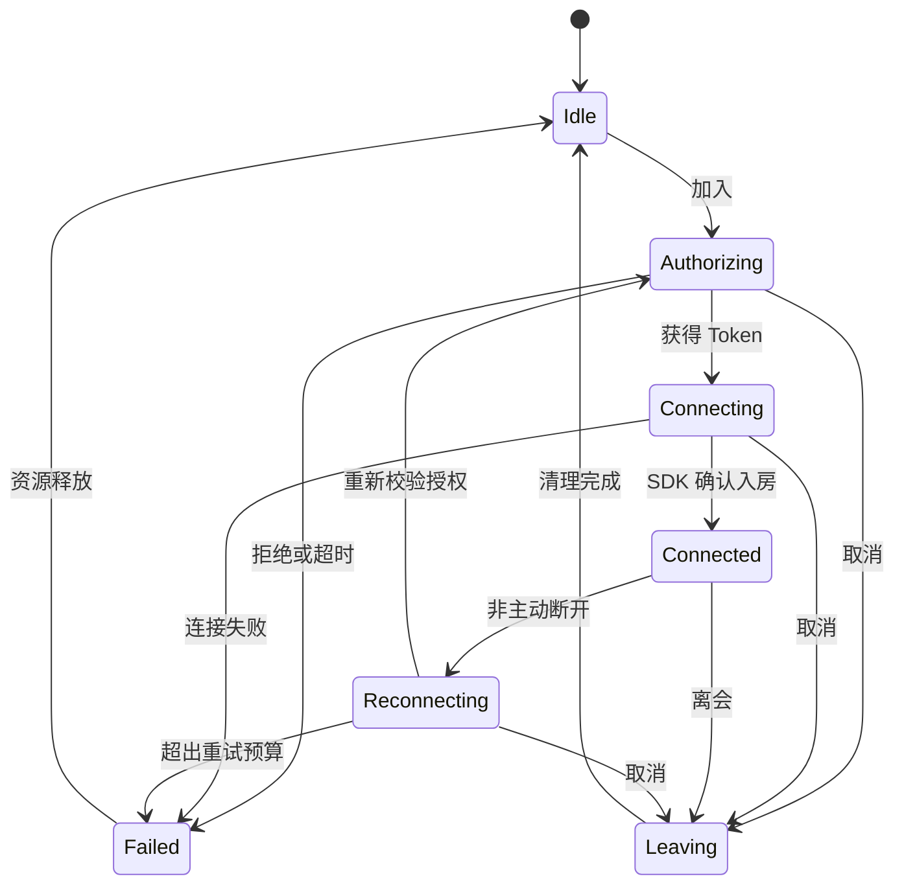

# livekit-app 客户端设计

实现补充：当前远控最小闭环已采用 ImGui + SDL2 被控端和 TypeScript 网页控制端，见 [运行文档](../../docs/remote-control/README.md)。下文 Qt 与账号/会议等为原平台目标设计，不是本次远控实现的技术栈。

版本：v0.1；日期：2026-10-26；状态：目标设计，仓库当前仅有初始化文件。

本仓库承载 AV Platform 产品客户端。平台职责和 HTTP 契约见 [总体设计](../../docs/platform-design.md)，媒体能力见 [SDK 设计](../../livekit-sdk-cpp/docs/design.md)。本文的目录、状态与接口除明确引用现有 SDK 外均为拟定方案。

## 1. 目标与边界

首期提供 Windows 桌面端的登录、会议列表、入会、成员/轨道展示、麦克风控制、连接反馈和离会。屏幕共享、设备选择、远控、播放器与剪辑分阶段接入。现有 SDK `demo/` 是会议观看示例，不直接作为完整产品，也不在本次迁移其代码。

客户端负责交互、呈现、系统权限引导和本地偏好；业务服务决定业务权限；SDK 管理媒体会话和设备。客户端不得持有媒体服务 API Secret，不得直接调用受信管理 API，不在 UI 中实现编解码或 RTP。

## 2. 技术方案与目录

推荐 Qt 6 / QML 负责 UI，C++ 应用层适配 `LiveKit::SDK`。选型在验证 I420 渲染、窗口生命周期、DPI、线程投递、打包和许可后确定。若改用其他 UI 框架，仍沿用下述状态和边界；已有 ImGui/SDL Demo 保留在 SDK 仓库用于回归。

拟定目录：

```text
src/app/             启动、依赖装配、窗口与退出协调
src/domain/          会议、设备、会话和控制权的 UI 无关模型
src/services/        登录、会议、设备与任务用例
src/infrastructure/  HTTP、凭证存储、配置、日志
src/media/           SDK 适配、帧队列、渲染桥接
src/features/        meeting、cast、remote_control、player、editor
ui/                  QML 页面、组件、主题与本地化
tests/               状态机、契约、窗口与真实媒体集成
packaging/           安装包、依赖与许可证清单
```

依赖方向为 UI → 用例/状态模型 → 业务 API 或 SDK 适配器。domain 不依赖 QML、WebRTC 或 HTTP 库；媒体适配层返回应用自有状态，不暴露 SDK 内部指针到 UI。

## 3. 组件设计

| 组件（拟定） | 职责与输入输出 |
| --- | --- |
| AppContext | 装配配置、登录状态、服务和媒体 Runtime；统筹退出 |
| AuthService | 应用登录、会话刷新、退出；刷新令牌写入操作系统凭证存储 |
| BusinessClient | `/api/v1` 请求、错误映射、取消、超时、request_id |
| MeetingController | 创建/加入/离开用例，协调 Token 获取与 SDK 生命周期 |
| MediaAdapter | 包装现有 Room，转换事件与帧，维护会话代次 |
| DeviceController | 能力/授权状态展示，后续调用 SDK 设备选择与热插拔 API |
| RenderBridge | 保持帧所有权，将媒体线程数据交给渲染线程 |
| ControlController | 本地同意、授权校验、停止控制入口与控制状态 |
| DiagnosticsService | 收集脱敏错误、版本与质量统计，按用户操作导出 |

暂不为了完整页面提前设计所有编辑器内部模型；剪辑工程与时间线语义由 SDK 提供，UI 只表达编辑意图与预览结果。

## 4. 状态与并发

应用认证状态为 signed_out/authenticating/signed_in/expired；会议会话状态为 idle/authorizing/connecting/connected/reconnecting/leaving/failed。认证失败和媒体失败分别展示，HTTP 401 不归类为解码错误。



每次加入分配本地 generation；所有异步结果携带 generation 和请求 ID。用户退出后迟到的 Token、连接成功和视频帧全部丢弃。重试需要创建新代次，控制权不自动继承。

UI 线程只更新状态与提交命令。SDK 现有 Room 回调在会话线程串行执行，回调中不得等待同一 Room 的 future；将轻量事件投递 UI，阻塞等待和 join/disconnect/wait 在串行生命周期执行器处理。窗口关闭先禁用新操作，再取消请求和停止媒体，完成后销毁依赖对象，不能让 SDK 回调访问已销毁窗口。

## 5. 媒体呈现与设备

I420 帧保留 SDK 提供的自有内存句柄；不能保存已释放临时数据指针。渲染桥接使用按轨道有界队列，首版建议只保留最新 1–2 帧，实际容量经测量确定。过载时丢弃旧视频帧并计数，不阻塞 SDK 控制回调；音频输出由 SDK 协调，不复用视频丢帧策略。

渲染线程拥有纹理与 GPU 上下文，停止轨道时先取消后续投递，再按渲染线程约束释放纹理。窗口隐藏、最小化和后台运行可降低渲染频率，但是否取消订阅由明确策略决定，不能混同为远端停止发布。

能力界面分别表达 supported、authorized、available、in_use。权限被拒、设备拔出、没有设备和后端不支持是不同状态；只有 SDK 报告可用时才启用功能。屏幕采集可用不能推导系统音频或输入注入可用。

## 6. 业务接口与缓存

入会通过 `POST /api/v1/meetings/{id}/join` 获得地址、短期 Token、到期时间、identity 与授予能力。客户端不能自行增加 publish/subscribe/data 权限。媒体 Token 仅驻留内存，日志不记录 Token；登录刷新令牌使用操作系统凭证存储，具体认证协议待业务端定案。

GET 可在预算内重试；非幂等操作只有带稳定 Idempotency-Key 且服务器支持幂等语义才自动重试。相同用户动作保持同一个键，新的动作生成新键。用户取消不意味着服务器未执行，恢复页面时通过查询对账。

本地持久化仅保存主题、窗口布局、最近设备等非敏感偏好，并带配置版本。会议在线成员以 SDK 实时事件为准，业务列表缓存标注更新时间。断网时允许查看缓存，不允许用缓存授权加入或远控。

## 7. 远控交互

被控端显示控制者、目标屏幕、权限范围与到期时间，提供始终可达的停止入口。用户明确同意后才确认授权；服务端授权、媒体身份和本地状态三者匹配后才输入注入。

显示布局变化时更新 layout_version 与坐标映射，旧版本控制消息拒绝或等待重新同步。鼠标移动合并，按键和按钮状态可靠有序处理。失焦策略需区分控制窗口与普通窗口；断线、退出、撤权、租约过期和进程关闭均释放已按下键与按钮。

首期不启用无人值守控制、剪贴板共享或文件传输；这些能力以后使用独立授权，不随“允许远控”隐式开放。

## 8. 错误、诊断与发布

UI 区分可重试网络错误、认证失效、无权限、设备授权缺失、后端不支持及内部失败；展示恢复动作与 request_id，详细诊断保存在脱敏日志。自动重试有退避和上限，用户主动停止立即终止后续尝试。

构建只链接 SDK 公共 target，不复制单个 `.lib` 作为完整依赖。Windows 与 SDK/WebRTC 使用兼容编译器、架构和 CRT；Qt 发行包也必须匹配，默认 `/MD` Qt 预编译包与现有 `/MT` 原生依赖不能直接混用，需要统一重建或通过明确 ABI 边界隔离。此项为框架原型的前置验证。

发布包含应用、运行依赖、配置模板和许可证清单；不得打包开发密钥。安装、升级、卸载、配置迁移与签名流程在发布阶段补齐。

## 9. 实施与验收

| 阶段 | 内容 | 验收重点 |
| --- | --- | --- |
| A | UI/SDK 桥接原型 | CRT 与依赖兼容；I420 显示；主线程不卡死；取消和关闭无迟到访问 |
| B | 登录和会议闭环 | 双用户真实音视频；无权限不入会；过期 Token 可恢复；离会清理 |
| C | 设备/屏幕共享 | 权限拒绝、拔插、多屏/DPI、慢渲染、反复发布订阅 |
| D | 远控 | 双端授权、撤权、断线释放、坐标版本、旧消息与重放拒绝 |
| E | 播放与剪辑 | 快速 Seek、取消预览、预览与导出一致、保存与恢复 |

单元验证状态机和错误映射；契约测试覆盖业务字段和 SDK 事件语义；集成验证真实媒体与资源清理。测试不得仅以按钮可点击或截图存在作为媒体成功依据。当前仓库尚未具备这些构建和测试入口。
